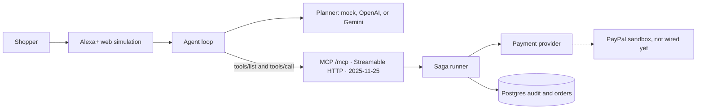

# Ledgerlane

Ledgerlane is an open-source **agentic commerce MCP gateway**. An assistant can search a catalog, compare options, build a cart, place an order, track it, and refund it. The part that matters is behind the tools: multi-step checkout with saga-style compensation, idempotency so a retry cannot capture a card twice, and a Postgres audit log of who did what, and why.

The web page is a simulation of an Alexa+ conversation. [Amazon's hackathon rules](https://amazonappdev2026.devpost.com/rules) allow that simulation when you do not have a device. The simulator does not fake the tools. It opens an MCP client and calls this server over Streamable HTTP, protocol revision **2025-11-25**.

No model key and no payment key are required. The default planner and the default card are mocks.

## The problem

A shopping agent that only wraps a product API can recommend a shoe. It cannot honestly say "I charged you" unless something durable sits behind the tool call:

- the total is read back and the shopper says yes before any capture
- a crash or a declined capture undoes the reservation instead of leaving a half-finished order
- a repeated request returns the same order
- a person can replay the turn later: which agent, which tool, which reason

Ledgerlane is that layer. Alexa+ (or the simulator standing in for it) is the caller. A PayPal sandbox adapter can replace the mock card later without rewriting the saga.

## Architecture



Detail is in [docs/ARCHITECTURE.md](docs/ARCHITECTURE.md).

### How this uses MCP and Alexa+

| Hackathon requirement | What this repo does |
| --- | --- |
| MCP spec 2025-11-25 or later | The official MCP Python SDK negotiates `2025-11-25`. |
| Streamable HTTP | `POST /mcp` (GET and DELETE as well). JSON responses for tool calls. |
| Runtime use, not a README mention | The simulator's agent loop imports `mcp.client` and calls the server over HTTP. |
| Web simulation allowed | `/` is that simulation. No Echo hardware. |
| Tools that chain | Search returns `sku`. Cart returns `cart_id`. Checkout returns `quote_id`. Order returns `order_id` and a tracking number. |
| Explicit confirm before money moves | `place_order` and `refund_order` no-op the charge until `confirm` is true. |

Alexa+ certification also wants a public HTTPS URL, a bare HTTP 401 (no `WWW-Authenticate` header), protected-resource metadata, and OAuth 2.1 with PKCE S256. Those endpoints are in the gateway so a later add-on can point at them. This submission does **not** register an Alexa+ add-on: that needs your Alexa developer account and the Alexa AI CLI. See [Open risks](#open-risks-against-the-amazon-rules).

## Run the demo

Docker Compose is the path to show a judge. It starts Postgres and the gateway in mock mode.

```bash
docker compose up --build
```

Open [http://localhost:4317](http://localhost:4317).

Click **Play a full order** (search, compare, cart, checkout, place, track). Then **Play a failed capture**. The reply says the checkout was rolled back. The ledger lists `capture_payment.failed` and the compensating steps.

Stop with Ctrl-C. Add `-d` if you want it in the background, and `docker compose down` to stop it.

### Demo script

Say, or click:

1. Find trail running shoes under 120 dollars
2. Compare the two cheapest
3. Add the cheaper pair to my cart
4. Check out
5. Yes, place the order
6. Where is my order?
7. Refund it, they don't fit
8. Yes, refund it

Failed capture, after a lamp is in the cart and checked out:

> Yes, place the order, but make the card capture fail

A scripted check against a running Compose stack:

```bash
python scripts/e2e_mock.py
```

### Call the MCP server yourself

Unauthenticated requests get **401** and no `WWW-Authenticate` header.

```bash
curl -s -D - -o /dev/null \
  -H 'content-type: application/json' \
  -H 'accept: application/json, text/event-stream' \
  -d '{"jsonrpc":"2.0","id":1,"method":"initialize","params":{}}' \
  http://localhost:4317/mcp
```

With the local demo token (this is not a production secret; it ships in `.env.example`):

```bash
curl -s http://localhost:4317/.well-known/oauth-authorization-server
# then any MCP client pointed at http://localhost:4317/mcp
# Authorization: Bearer demo-shopper-token
```

Client id `demo-client` / secret `demo-secret` can mint that same token from `POST /oauth/token` with `grant_type=client_credentials`. PKCE S256 is implemented for the authorization-code shape Alexa+ describes. It is a demo issuer so the metadata is real; replace it before any non-local deployment.

## Tests

Unit tests cover the saga, compensation order, idempotency, and refunds without Docker. One test boots the gateway and drives both the MCP client and the simulator.

```bash
python -m venv .venv
source .venv/bin/activate
pip install -e '.[dev]'
pytest
```

## Configuration

Copy `.env.example` to `.env` only when you want to override Compose. Keys are read from the environment. None are baked into the image.

| Variable | Default | Role |
| --- | --- | --- |
| `DATABASE_URL` | `memory` outside Compose | Compose sets Postgres. `memory` is for tests. |
| `LLM_PROVIDER` | `mock` | `openai` or `gemini` to swap the planner. |
| `OPENAI_API_KEY`, `OPENAI_BASE_URL`, `OPENAI_MODEL` | empty | Used when `LLM_PROVIDER=openai`. |
| `GEMINI_API_KEY`, `GEMINI_BASE_URL`, `GEMINI_MODEL` | Gemini's OpenAI-compatible endpoint | Used when `LLM_PROVIDER=gemini`. |
| `PAYMENT_PROVIDER` | `mock` | `paypal` selects the sandbox seam, which still refuses live calls. |
| `PAYPAL_CLIENT_ID`, `PAYPAL_CLIENT_SECRET`, `PAYPAL_API_BASE` | empty | Reserved for the PayPal sandbox adapter. |
| `ACMG_DEMO_TOKEN` | `demo-shopper-token` | Bearer token for `/mcp` in demo auth mode. |
| `PUBLIC_BASE_URL` | `http://localhost:4317` | Issuer and MCP resource URL in OAuth metadata. |
| `MCP_INTERNAL_URL` | `http://127.0.0.1:4317/mcp` | Where the agent loop calls the server. |

If you set `LLM_PROVIDER=gemini` and leave `GEMINI_API_KEY` empty, startup of a chat turn fails with a clear error instead of pretending to answer. Mock mode does not do that.

## What was built during the hackathon

The Amazon "Build, Ship, Shape" submission window opened on August 31, 2026. This project was created on October 19, 2026, inside that window. There was no earlier private version. The work in the window is the whole gateway: MCP tools, saga runner, idempotency, Postgres audit log, mock payments, the PayPal provider interface, the web simulator, tests, and the docs under `docs/`.

Devpost field draft: [docs/devpost-submission.md](docs/devpost-submission.md). Shot list for the video: [docs/demo-video-script.md](docs/demo-video-script.md).

## Project layout

```
src/acmg/            gateway, MCP tools, saga, stores, simulator
src/acmg/static/     Alexa+ simulation page
tests/               saga, refund, OAuth PKCE, live MCP client
docs/                architecture, Devpost draft, video script
docker-compose.yml   Postgres + gateway, mock mode
```

## License

Apache License 2.0. See [LICENSE](LICENSE).

## Open risks against the Amazon rules

Checked against the rules page and the [Alexa+ MCP quickstart](https://developer.amazon.com/docs/alexaplus/add-ons/mcp-toolkit-quickstart.html) on October 19, 2026.

- **Add-on not deployed.** A certified Alexa+ add-on needs your developer account, `alexa-ai`, a public HTTPS URL, privacy and terms URLs, and icon assets. This repo implements the MCP server and the allowed web simulation. It does not submit an add-on. Judges who only accept a live add-on id would be applying a bar the written rules do not require; the rules explicitly allow the simulation.
- **Auth is a demo issuer.** The 401 shape, protected-resource metadata, and PKCE S256 match the published checklist. The token is a fixed demo bearer, not Login with Amazon, and dynamic client registration is intentionally absent because Alexa+ does not support it yet. Do not expose this issuer on the public internet as if it were production.
- **Latency budget.** Certification asks for a round trip under 500 ms. Local tools are single queries. That number is not a hackathon pass/fail in the rules text, and it has not been measured from Alexa+'s network.
- **Open Source mini challenge wording.** The rules say a *new, additional* open-source project alongside the primary submission. This repository is the primary project and it is Apache-2.0. Treat the mini challenge as optional until you decide you can describe it that way. Do not also claim AWS Builder: no AWS runtime is called. AWS credits for the event were already exhausted on October 7, 2026.
- **Video and trademarks.** The video must be public on YouTube or Vimeo, under 3 minutes, English, and must show the project running. The rules also say not to include third-party trademarks without permission. The page says "Alexa+" because that is the simulated experience the track asks for. Avoid Amazon logos, and avoid copyrighted music.
- **Repo access.** A public repo needs a detectable OSI license (this one is Apache-2.0). A private repo must invite the GitHub accounts listed in the rules, and invitations expire after seven days. This workspace was not published and was not submitted to Devpost.
- **Eligibility and prizes.** You must be the age of majority where you live. The rules exclude some territories; read the list yourself. Prize tax forms (including W-8BEN if you are outside the United States) are your responsibility. Nothing here is legal or tax advice.
- **One prize track.** A project can win one track prize and one mini-challenge prize. This draft enters Alexa+ only.
