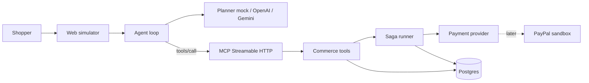

# Architecture

Ledgerlane is an agentic commerce gateway. An assistant (in this repo, a web simulation of the Alexa+ conversation) never touches the database. It calls a Model Context Protocol server. The server runs multi-step checkout and refund workflows, and writes a replayable audit row for every step.

## Request path

1. The shopper types in the simulator. Official Alexa+ rules also allow this web simulation when no device is available.
2. `AgentLoop` opens an MCP client session to `MCP_INTERNAL_URL` (Streamable HTTP, JSON responses, protocol 2025-11-25) and sends the bearer demo token.
3. The planner (`LLM_PROVIDER=mock` by default) chooses a tool. OpenAI and Gemini are OpenAI-compatible HTTP clients selected by env vars. Keys are never stored in the repo.
4. The MCP server validates the bearer token. A missing token is HTTP 401 with no `WWW-Authenticate` header, matching the current Alexa+ account-linking checklist. Protected-resource and authorization-server metadata are published for discovery, including PKCE `S256`.
5. The tool runs inside `CommerceService`. Checkout and refund are sagas. Each step and each compensation is an audit event.

## Saga

`place_order` claims the quote and reserves stock, authorizes the card, creates the order, captures, then opens a shipment. A failed step compensates completed steps in reverse:

| Failed step | Compensation |
| --- | --- |
| reserve / claim | nothing committed |
| authorize | release stock, reopen quote |
| create order | void the authorization, release stock |
| capture | cancel the order, void the authorization, release stock |
| shipment | refund the capture, cancel the order, void is a no-op once refunded, release stock |

A quote is claimed with a compare-and-set (`status = open`) in the same transaction as the stock decrement, so two checkouts cannot sell the same unit. Compensation reopens the quote.

`refund_order` refunds the capture, restocks, then marks the order refunded. A refund is not reversed if a later step fails: the ledger records `compensation_failed` instead of putting the charge back.

`simulate_failure` is a demo-only argument. It is how the simulator shows a rollback without a flaky dependency.

## Idempotency

`place_order` and `refund_order` require an idempotency key. The key plus a hash of the request is stored before the saga starts.

- Same key, same hash, finished: return the stored result. The mock card is not authorized again.
- Same key, different hash: conflict.
- Same key, still `in_progress`: ask the caller to wait. A crash in that window is visible and is not auto-retried, which avoids a double capture. Resuming an in-progress saga is future work.

The mock provider also deduplicates authorize by its own idempotency key.

## Audit log

Table `audit_events` in Postgres (or the in-memory store used by unit tests). Every row has:

- who: `actor_type`, `actor_id`, `customer_id`
- what: `tool_name`, `action`, `status`, input and output JSON
- why: `reason` supplied by the agent
- grouping: `session_id`, `correlation_id` (one shopper turn), `saga_id`

`GET /api/audit?correlation_id=` returns the turn in order. That is the replay.

The customer-facing reply does not include tool names or saga vocabulary. The side panel in the simulator is the operator view of the same rows.

## Payments

`PaymentProvider` is `authorize`, `capture`, `void`, `refund`. `MockPaymentProvider` persists those transitions in the `payments` table so a refund still works after a process restart.

`PayPalSandboxProvider` documents the Orders v2 calls (create order with `intent=AUTHORIZE`, authorize, capture, void, refund) and refuses to run them. It is selected only with `PAYMENT_PROVIDER=paypal`, and even then it fails closed until the November hackathon wires the sandbox. That gap is intentional: the PayPal event scores work done during its own submission window.

## Alexa+ protocol surface

Implemented now:

- Streamable HTTP on `POST/GET/DELETE /mcp`, MCP Python SDK, negotiated protocol `2025-11-25`
- JSON responses for short tool calls (the spec allows JSON or SSE; Alexa+ must accept both)
- DNS-rebinding checks on `Host` and `Origin`
- Tool schemas whose outputs are stable ids (`sku`, `cart_id`, `quote_id`, `order_id`) so one call feeds the next
- Explicit confirm flags before charge and refund
- Demo OAuth: `/.well-known/oauth-protected-resource`, `/.well-known/oauth-authorization-server` with `code_challenge_methods_supported: ["S256"]`, authorization-code + PKCE, and client-credentials for the simulator

Not done, because they need the entrant's Alexa developer account and a public HTTPS URL:

- `alexa-ai` add-on package, icons, privacy policy, and certification
- A real OAuth authorization server (dynamic client registration is unsupported by Alexa+ today; a pre-registered client is the expected shape)
- The sub-500ms budget is a certification target. Local tool calls are single queries; measure them again once the server is on a public URL

## Process model

`docker compose up` starts Postgres 16 and one gateway process. The gateway serves the simulator, the OAuth metadata, and the MCP session manager in the same event loop, so the agent can call back into `/mcp` without a second worker. Commerce state is in Postgres. Chat transcripts are process memory; the audit rows are not.

`DATABASE_URL=memory` skips Postgres for unit tests and a laptop demo. The supported hackathon path is Compose, so judges see the durable ledger.
